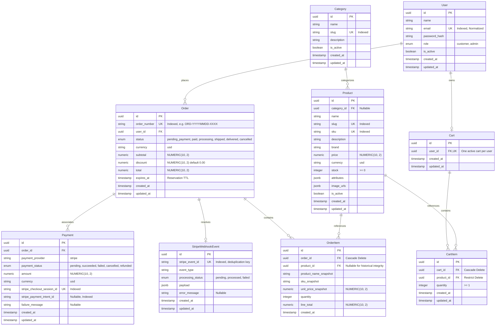

# VendorIQ — Database Schema Specification

## 1. Entity Relationship Overview

The schema is built on **PostgreSQL** using UUIDv4 primary keys across all tables, explicit foreign keys, indexes on queried columns, and fixed-precision `NUMERIC(10, 2)` types for all monetary calculations.

---

## 2. Table Specifications & Constraints

### 2.1 `users`
* `id` (UUID, PK): Auto-generated UUIDv4.
* `email` (VARCHAR(255), UNIQUE, NOT NULL): Normalized to lowercase, indexed for O(1) authentication lookups.
* `password_hash` (VARCHAR(512), NOT NULL): Argon2id hash string.
* `role` (VARCHAR(32), NOT NULL): Enforced via check constraint or enum: `'customer'`, `'admin'`. Default: `'customer'`.
* `is_active` (BOOLEAN, NOT NULL, DEFAULT TRUE): For account suspension.

### 2.2 `categories`
* `id` (UUID, PK): Primary key.
* `name` (VARCHAR(255), NOT NULL).
* `slug` (VARCHAR(255), UNIQUE, NOT NULL): URL-safe lowercase slug (e.g. `"electronics"`).
* `description` (TEXT, NULLABLE).
* `is_active` (BOOLEAN, DEFAULT TRUE): Soft toggle for category visibility.

### 2.3 `products`
* `id` (UUID, PK): Primary key.
* `category_id` (UUID, FK -> `categories.id`, ON DELETE SET NULL, NULLABLE).
* `name` (VARCHAR(255), NOT NULL).
* `slug` (VARCHAR(255), UNIQUE, NOT NULL): URL-safe slug.
* `sku` (VARCHAR(100), UNIQUE, NOT NULL): Stock Keeping Unit.
* `description` (TEXT, NULLABLE).
* `brand` (VARCHAR(100), NULLABLE).
* `price` (NUMERIC(10, 2), NOT NULL): Exact decimal representation. Must be `>= 0`.
* `currency` (VARCHAR(3), NOT NULL, DEFAULT `'usd'`).
* `stock` (INTEGER, NOT NULL, DEFAULT 0): Must be `>= 0` (enforced via DB CHECK constraint `stock >= 0`).
* `attributes` (JSONB, NOT NULL, DEFAULT `'{}'`): Arbitrary key-value specs (color, size, weight).
* `image_urls` (JSONB, NOT NULL, DEFAULT `'[]'`): Array of string URLs.
* `is_active` (BOOLEAN, NOT NULL, DEFAULT TRUE): Soft deactivation.

### 2.4 `carts` & `cart_items`
* `carts.user_id` (UUID, UNIQUE, FK -> `users.id`, ON DELETE CASCADE): Each customer has exactly one active cart.
* `cart_items.cart_id` (UUID, FK -> `carts.id`, ON DELETE CASCADE).
* `cart_items.product_id` (UUID, FK -> `products.id`, ON DELETE RESTRICT).
* Unique constraint on `(cart_id, product_id)` ensures a product appears at most once per cart.
* `quantity` (INTEGER, NOT NULL): Must be `>= 1`.

### 2.5 `orders` & `order_items`
* `orders.order_number` (VARCHAR(64), UNIQUE, NOT NULL): Human-readable tracking number format `ORD-YYYYMMDD-XXXX`.
* `orders.status` (VARCHAR(32), NOT NULL, DEFAULT `'pending_payment'`): Enforced enum (`pending_payment`, `paid`, `processing`, `shipped`, `delivered`, `cancelled`).
* `orders.expires_at` (TIMESTAMP WITH TIME ZONE, NOT NULL): Timestamp after which the checkout reservation expires.
* `order_items.product_id` (UUID, NULLABLE, FK -> `products.id`, ON DELETE SET NULL): Protects historical order integrity if catalog items are deactivated.
* `order_items` **snapshots**: Stores `product_name_snapshot`, `sku_snapshot`, `unit_price_snapshot` at the exact moment of checkout. Catalog price changes never corrupt past orders.

### 2.6 `payments`
* Correlates internal orders with external Stripe transactions.
* `stripe_checkout_session_id` (VARCHAR(255), UNIQUE, NOT NULL): Maps 1-to-1 with Stripe's `cs_test_...` session.
* `stripe_payment_intent_id` (VARCHAR(255), NULLABLE): Captured when checkout completes or payment intent is confirmed.

### 2.7 `stripe_webhook_events`
* `stripe_event_id` (VARCHAR(255), UNIQUE, NOT NULL): Stripe's `evt_...` identifier.
* Provides **guaranteed idempotency**: Duplicate webhook deliveries for the same event ID are detected before any database mutation occurs.
