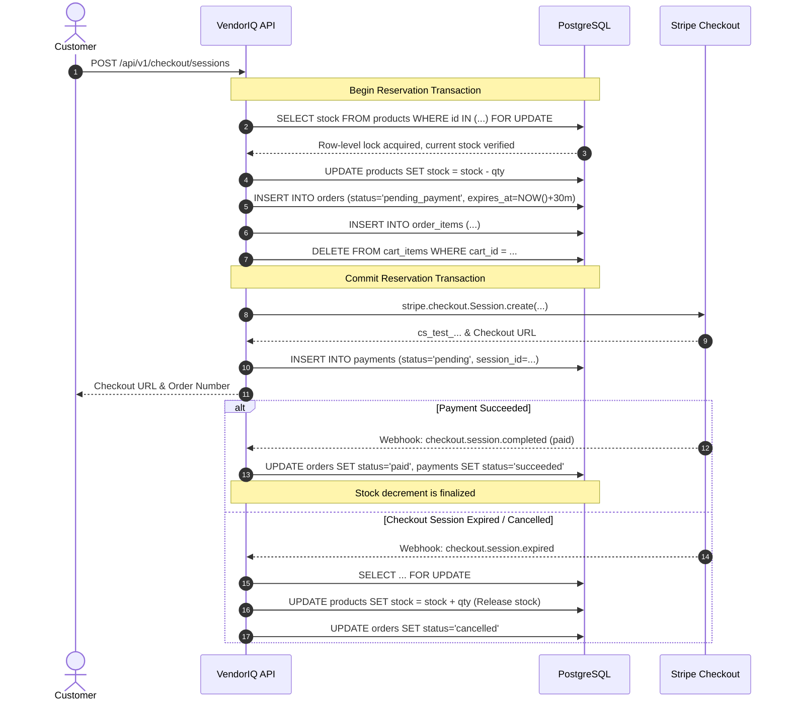

# VendorIQ — Inventory Policy & Order Lifecycle Specification

## 1. Inventory Policy: Short-Lived Reservation Model

VendorIQ implements a **Short-Lived Reservation Model** to eliminate overselling and race conditions when multiple customers compete for the last item in stock.



---

## 2. Preventing Concurrency Bugs & Race Conditions

### 2.1 The Read-Then-Write Flaw
In a naive system:
1. Thread A reads `stock = 1`.
2. Thread B reads `stock = 1`.
3. Thread A checks out and writes `stock = 0`.
4. Thread B checks out and writes `stock = 0`.
*Result*: 2 customers paid for 1 item (overselling).

### 2.2 PostgreSQL Row-Level Locking (`SELECT ... FOR UPDATE`)
In VendorIQ:
```python
stmt = select(Product).where(Product.id.in_(product_ids)).with_for_update()
products = (await session.execute(stmt)).scalars().all()
```
* PostgreSQL locks the specific product rows until the checkout transaction commits.
* Thread B blocks until Thread A commits. When Thread B acquires the lock, it reads `stock = 0` and receives an immediate `409 Conflict: Insufficient stock`.
* DB constraint: A PostgreSQL check constraint `CHECK (stock >= 0)` guarantees stock can never become negative under any circumstance.

---

## 3. Order State Machine

The order lifecycle enforces strict, unidirectional transitions:

```
[pending_payment]
       │
       ├─────────────────────────────────┐
       ▼ (payment succeeded)             ▼ (session expired / customer cancel)
     [paid]                         [cancelled] (Stock Released)
       │
       ▼ (admin updates)
  [processing]
       │
       ▼ (admin updates)
   [shipped]
       │
       ▼ (admin updates)
  [delivered]
```

### 3.1 Legal State Transitions

| Current Status | Permitted Next Status | Trigger / Authorized Role | Stock Action |
| :--- | :--- | :--- | :--- |
| `pending_payment` | `paid` | Webhook (`checkout.session.completed` with `paid`) | Finalize decrement |
| `pending_payment` | `cancelled` | Customer cancellation OR Webhook (`session.expired`) | Restore/release stock |
| `paid` | `processing` | Admin (`PATCH /api/v1/admin/orders/{id}/status`) | None |
| `processing` | `shipped` | Admin (`PATCH /api/v1/admin/orders/{id}/status`) | None |
| `shipped` | `delivered` | Admin (`PATCH /api/v1/admin/orders/{id}/status`) | None |
| `paid` | `cancelled` | Admin Only (Special cancellation workflow) | Restore stock |
| `cancelled` / `delivered` | *Terminal* | No further transitions permitted | None |

---

## 4. Historical Snapshot Preservation

When an order is created, the system copies critical product data into the immutable `order_items` table:
* `product_name_snapshot`: Product title at purchase time
* `sku_snapshot`: SKU at purchase time
* `unit_price_snapshot`: Exact unit price paid
* `quantity`: Units ordered
* `line_total`: `unit_price_snapshot * quantity`

If a merchant subsequently renames a product, increases its price, or deactivates it in the catalog, **past orders remain 100% intact, immutable, and mathematically accurate**.
